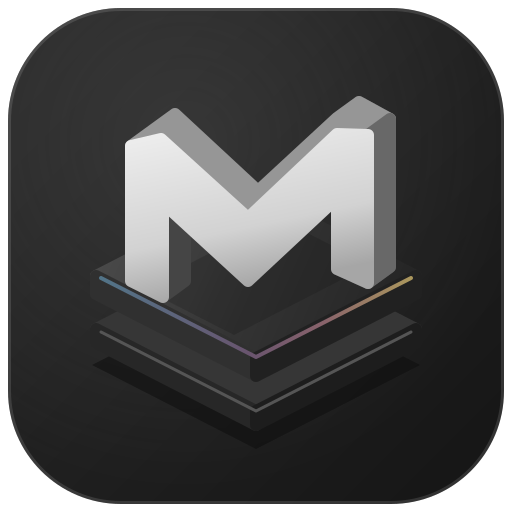

<div align="center">



# MMM

**Marvel Rivals Mod Manager**

A clean modpack and `.pak` mod manager for Marvel Rivals. Build collections, enable or disable mods, move them between packs, and launch the game in one click.

[](https://dotnet.microsoft.com/)
[](https://avaloniaui.net/)
[](#requirements)
[](https://github.com/extrapolate1337/MMM)

[Features](#-features) · [Quick start](#-quick-start) · [Build](#-build) · [Project structure](#-project-structure)

</div>

---

## ✨ Features

| | |
|---|---|
| 🗂️ **Modpacks** | Create, rename, and delete mod collections. Every modpack is a separate folder. |
| 🎛️ **Mod control** | Enable or disable `.pak` mods without deleting files. Disabled mods get a `🚫` prefix. |
| 📦 **Archive import** | Add mods from `.zip`, `.7z`, `.rar`, and other common formats via SharpCompress. |
| 🔀 **Copy & move** | Move selected mods between modpacks in a couple of clicks. |
| 🚀 **Game launch** | Automatically installs mods into `Content/Paks/~mods` and starts Marvel Rivals through Steam. |
| 🧩 **Bypass included** | `dsound.dll` and `MarvelRivalsUTOCSignatureBypass.asi` are embedded in the app and installed automatically. |
| 🎨 **Custom UI** | A dark, custom-drawn Avalonia window with drag support and its own icon. |

---

## 🚀 Quick start

1. **Launch `MMM.exe`**
2. Click **+** next to **ModPacks** to create a modpack.
3. Click **+** next to **Addons Manager** and select your mod archives.
4. Click **Set game folder** and select the Marvel Rivals game folder
5. Select a modpack and press **Start** — the game launches with its active mods.

> 💡 Close the game before launching. MMM clears the `~mods` folder and copies only enabled mods into it.

---

## 🧠 How it works

```
MMM/
└── modpacks/
    ├── Anime Pack/
    │   ├── skin_001_P.pak
    │   └── 🚫skin_002_P.pak   ← disabled
    └── Vanilla+/
        └── ui_fix_P.pak
```

When you press **Start**, the app:

1. Validates the selected game folder and the `Marvel/Binaries/Win64` structure.
2. Installs `dsound.dll` and the bypass plugin.
3. Clears `Marvel/Content/Paks/~mods`.
4. Copies every `.pak` file from the selected modpack except disabled ones.
5. Opens the game via `steam://run/2767030`.

---

## 🛠️ Tech stack

| Component | Version |
|---|---|
| .NET | 10.0 |
| Avalonia UI | 11.3.4 |
| SharpCompress | 0.48.0 |
| SevenZip | 19.0.0 |
| Device.Net | 4.2.1 |

---

## 📋 Requirements

- **Windows 10/11** or **Linux** (including Steam Deck)
- [.NET 10 Runtime](https://dotnet.microsoft.com/download) (unless you use a self-contained build)
- **Marvel Rivals** installed via Steam
- Write access to the game folder

### Linux and Steam Deck

MMM runs on .NET on Linux. Steam runs Marvel Rivals through Proton. In Steam, open the game's **Properties → General → Launch Options** and enter:

```sh
WINEDLLOVERRIDES="dsound=n" %command%
```

This tells Proton to load the `dsound.dll` that MMM installs alongside the game executable.

---

## 🔨 Build

```bash
git clone https://github.com/extrapolate1337/MMM.git
cd MMM
dotnet restore
dotnet run --project MMM.csproj
```

Single-file release build:

```bash
dotnet publish MMM.csproj -c Release -r win-x64 --self-contained true -p:PublishSingleFile=true
```

The output will be available at:

```
bin/Release/net10.0/win-x64/publish/MMM.exe
```

---

## 📁 Project structure

```
MMM/
├── Forms/                  # Avalonia windows (main, warning, about)
├── Services/
│   ├── ArchiveService.cs   # Archive extraction
│   ├── GameService.cs      # Mod installation and game launch
│   ├── ModPackService.cs   # Modpack management
│   └── ModService.cs       # Enabling, deleting, and moving mods
├── Resources/
│   ├── icon/               # App icons
│   ├── images/             # Background images
│   ├── plugins/            # Bypass plugin
│   └── dsound.dll
├── App.axaml               # Avalonia entry point
├── Program.cs              # Application bootstrap
├── MMM.csproj
└── MMM.sln
```

The `MMM/modpacks/` folder is created automatically on first launch and is excluded from Git.

---

## Useful tools for mods

- [repak-rivals](https://github.com/natimerry/repak-rivals/) can convert legacy `.pak` mods to IoStore and rebuild existing `.pak`, `.utoc`, and `.ucas` sets. It can help with packaging issues after a game update. Mods with outdated assets may still need an update from their author.
- [UTOC Signature Bypass by DeathChaos](https://www.nexusmods.com/marvelrivals/mods/2940) is the original plugin for loading unsigned IoStore mods. A [Performance DLC (PBO) compatible version](https://www.nexusmods.com/marvelrivals/mods/14652?tab=description) is also available.

---

## ⚠️ Disclaimer

This project is not affiliated with Marvel, NetEase, or Steam. Use mods and third-party libraries at your own risk — they may violate the game's rules. The author is not responsible for possible bans or damaged files.

---

<div align="center">


**[GitHub](https://github.com/extrapolate1337/MMM)** · **[Report an issue](https://github.com/extrapolate1337/MMM/issues)**

</div>
